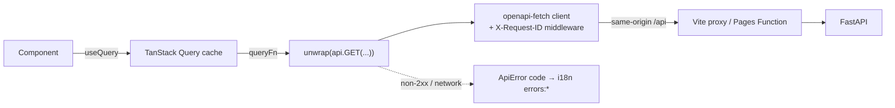
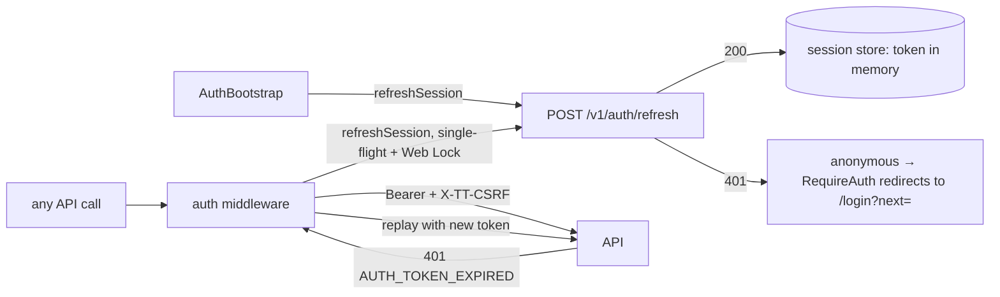
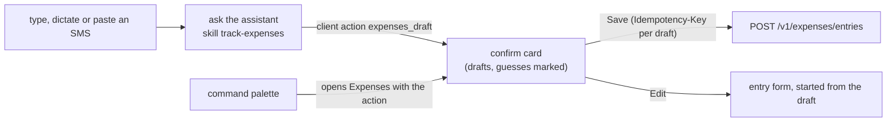

# Frontend architecture

This page summarises how the frontend is built. The cross-repo design is in the backend
repo's [plan.md](https://github.com/poornimapm/tech-toppings-backend-v1/blob/develop/docs/plan.md)
and [ADRs](https://github.com/poornimapm/tech-toppings-backend-v1/tree/develop/docs/adr).

## Layers

| Layer         | Folder               | May import          |
| ------------- | -------------------- | ------------------- |
| Core          | `src/core`           | libraries           |
| Platform      | `src/platform`       | core, design-system |
| Design system | `src/design-system`  | core                |
| Modules       | `src/modules/<slug>` | core, design-system |

Imports always use the `@/` alias. ESLint restricted-import rules stop modules importing each
other or reaching into `src/platform`.

## Data flow



- **Types.** `src/core/api/schema.d.ts` is generated from the backend's OpenAPI schema
  (`npm run gen:api`). Paths, params and bodies are type-checked against the real API,
  including the error envelope.
- **Errors.**
  - `unwrap()` throws one `ApiError(status, code, message, details, requestId)`.
  - UI code translates by `code` using `errorKey()`, which falls back to `UNKNOWN` for codes
    it doesn't know.
  - `requestId` matches the backend's log lines.
- **Retries.** The default query client retries only transient failures (network, 502, 503,
  504), at most twice. 4xx responses are never retried.

## Authentication



- **Session state** (`core/auth/session-store.ts`):
  - `status` is `unknown` (splash), `authenticated` or `anonymous`.
  - The access token and user are held in memory only. The refresh cookie is httpOnly and
    the app never reads it.
- **Refreshing** (`core/auth/session.ts`):
  - Concurrent callers share one request.
  - Tabs serialise through `navigator.locks` where available.
  - A `409 AUTH_REFRESH_RACE` (another tab just rotated the cookie) is retried once.
- **Middleware** (`core/auth/auth-middleware.ts`, installed by `core/auth/install.ts`):
  - It keeps a clone of each request, so it can be replayed after a refresh, body included.
  - Credential endpoints (login, register, refresh, logout, google) are never replayed.
- **Guards** (`core/auth/guards.tsx`):

  | Guard                  | Behaviour                                                         |
  | ---------------------- | ----------------------------------------------------------------- |
  | `RequireAuth`          | Redirects anonymous visitors to sign in                           |
  | `RequirePasswordFresh` | Sends an account with a pending admin reset to `/change-password` |
  | `PublicOnly`           | Sends signed-in users on to `next` (same-app paths only)          |

- **Preferences:** the language and theme controls PATCH `/v1/me` when signed in, and
  `PreferenceSync` applies the account's saved values on sign-in.
- **Cache hygiene:** user-scoped queries live under `['user', …]` and are removed when the
  signed-in account changes.

## Server availability (free-tier cold starts)

`useServerStatus()` polls `/healthz`:

| State      | Meaning                                        |
| ---------- | ---------------------------------------------- |
| `checking` | First request is in flight                     |
| `waking`   | Still pending after `VITE_WAKE_THRESHOLD_MS`   |
| `online`   | `/healthz` answered                            |
| `offline`  | Retry budget (`VITE_WAKE_MAX_WAIT_MS`) used up |

- Retries back off at 1 s, 2 s, 4 s, then every 5 s.
- `ServerStatusBanner` explains the waking state and offers _Try again_ when offline. It is
  a polite live region.
- `useReadiness()` (`/readyz`) runs only once the API is online.

## Modules

Each module is a folder `src/modules/<slug>/` (the backend key with `-` for `_`, e.g.
`gov-docs`) with a `manifest.ts`:

```ts
export default defineModule({
  key: 'expenses', // the backend manifest key
  icon: Wallet, // lucide-react
  accent: 'emerald', // a contrast-checked token pair in tokens.css
  keywords: ['money', 'budget', 'பணம்', 'पैसा'],
  strings: { en: { name, tagline, description, stats }, ta: {...}, hi: {...} },
  routes: [...], // optional lazy pages, mounted at /m/<slug>/*
});
```

- `core/modules/registry.ts` collects manifests with `import.meta.glob` at build time and
  fails loudly if a folder doesn't match its key or a key repeats. Adding a folder is the only
  step needed.
- `core/modules/queries.ts` merges `GET /v1/modules` with the manifests into tiles, in the
  user's order. The API decides status, availability, pins and order. A module the API lists
  but this build has no folder for still shows, with a neutral placeholder.
- Preference changes (pin, on/off, order, notify me) update the cache optimistically and roll
  back if the API refuses.
- `platform/shell/module-routes.tsx` mounts module pages behind `ModuleGate`, which explains
  when a module is off. The API enforces the same rule (`403 MODULE_DISABLED`).
- `ModuleRegistryContext` lets tests (and future previews) render with another registry.

**What a module brings, so the shell never names it.** Beside `name`, `tagline` and
`description`, a module's manifest can hold:

| In the manifest   | Used by                                                             |
| ----------------- | ------------------------------------------------------------------- |
| `strings.stats`   | the figure on its Welcome tile                                      |
| `strings.widgets` | titles of its dashboard widgets                                     |
| `strings.feed`    | wording of its activity entries and notifications (`useFeedText`)   |
| `strings.replies` | wording of its skills' static-mode answers (`useAgentText`)         |
| `actions`         | pages the assistant's client tools may open: tool name to page path |

Only that small, always-needed text is in the manifest. The module's own screens are worded
in its `i18n/{en,ta,hi}.json`, registered under a namespace named after the module
(`addModuleMessages`) and loaded with its pages. The module adds its English shape to
`ModuleMessages`, so its keys are type-checked like the shell's, and its tests check that
Tamil and Hindi have the same keys and placeholders (`expectSameKeysAndPlaceholders`).

A module imports only `@/core`, `@/design-system` and its own folder; ESLint enforces it
per module.

## Expenses

`src/modules/expenses/`, mounted at `/m/expenses`:

| File                                              | What it is                                                        |
| ------------------------------------------------- | ----------------------------------------------------------------- |
| `api.ts`                                          | queries and changes; a change refreshes every `['user', …]` query |
| `entries-page.tsx`                                | the list by day, totals, filters in the URL, add                  |
| `entry-form.tsx`                                  | add or edit, in a dialog                                          |
| `entry-page.tsx`                                  | one entry, its history, restore, delete with undo                 |
| `categories-dialog.tsx`                           | the user's own categories                                         |
| `category-book.ts`, `field-text.ts`, `periods.ts` | names, values and periods as the user reads them                  |

- **Money** is whole minor units everywhere; `core/utils/money.ts` reads what people type
  (on the digits, never through floating point) and formats amounts with `Intl`.
- **Adding** sends an `Idempotency-Key` made once per form, so saving again after a lost
  reply cannot add the entry twice.
- **Editing** sends the revision that was edited. If the entry changed elsewhere, the form
  says so and offers to reload it; nothing is overwritten.
- **Deleting** shows a toast with Undo; deleted entries have their own filter and can be
  brought back there or on their page.
- **History** lists each change with its fields in words (`Amount: ₹125 → ₹180`) and offers
  "Restore this version" on every earlier one.
- Money received is marked with a plus sign as well as a colour; a chosen category shows a
  tick as well as a tint.
- On phones the Add button floats above the navigation bar; on wider screens it is in the
  page header. It is one button, moved by CSS.

**Capture** (`capture-panel.tsx`, `quick-add.tsx`, `drafts-tray.tsx`, `capture.ts`):



- The quick-add bar sends the text with `skill: track-expenses` and `context.input_type`.
  Whether AI or the rule parser reads it is the server's choice; the page shows which
  ("Read in AI" / "Read in Quick mode"), the reason when neither can, and the button to turn
  AI on when consent is the reason.
- Drafts come from a model or a parser, so `draftsFrom` trusts nothing about their shape:
  anything missing or odd becomes an empty field to fill in.
- The confirm card saves complete drafts as they are and opens the others in the entry form.
  Fields that were guessed are listed ("Check: Amount, Category"); nothing is saved until
  the user saves it.
- **Dictation** (`core/speech`) uses the browser's speech recognition in the user's language
  (`<language>-VITE_SPEECH_REGION`, e.g. `ta-IN`), shows the words as they are heard, and
  leaves them editable. The microphone shows only where the browser can listen.
- **Read-back** says "Added Vegetables, ₹250.50" with a device voice for the language when
  there is one; the toast always shows it. It is a switch on the bar, remembered on the
  device.
- Drafts prepared in the command palette arrive with the action in the router state
  (`MODULE_ACTION`): the shell passes any client action to the page it opens, so this needs
  nothing module-specific in the shell.

**Quantities and prices** (`units.ts`, `prices-page.tsx`, `product-page.tsx`,
`product-settings.tsx`, `price-chart.tsx`, `matches.ts`, `matches-panel.tsx`,
`entry-price.tsx`):

- The entry form, drafts and list show how much was bought ("2 kg"); the form says what that
  comes to per unit while typing ("That's ₹50/kg"). Units come from `GET /units`; their names
  and plurals are module strings (`unit.*`, `quantity.*`), falling back to the code.
- **Entries | Prices** tabs (`section-tabs.tsx`) switch between the module's two sides;
  `paths.ts` builds the module's links from its manifest key.
- **Prices** lists what is bought: last price per unit, the change since the time before (an
  arrow and words, not only colour), a small trend line, where it was last bought and where
  it is cheapest. **Find matches** runs the `tidy-products` skill; its suggestions are cards
  to combine, mark "not the same" or skip. Matches the command palette prepared arrive with
  the page, as drafts do.
- **A product**: price tiles, a price chart with a line per place, places by average price,
  every purchase in a table (each links to its entry), and settings: price alert, price unit,
  names, rename, combine with another product, stop following.
- **The price chart** draws one line per place in the series colours (`--tt-series-1..5`,
  validated together for colour-blind separation on the surface in both themes), behind them
  a thin dashed line through every purchase in order (the trend when places alternate). A
  place keeps its colour: colours go by the order places were first bought at, and past five
  places those found last share "other places". Three light colours are under 3:1, so the
  chart always has a legend in text and the purchases are listed beside it. A readout above
  the plot says the purchase under the crosshair (pointer or arrow keys, `role="slider"`),
  so nothing covers the marks. The chart scale helpers
  (`niceRange`, `useMeasuredWidth`) live in `design-system/charts` and the dashboard chart
  uses them too.
- An entry of something bought shows what it came to per unit and leads to its price
  history, or offers to follow its price.
- **Notifications** say money in the user's language: a parameter `<name>_minor` beside a
  `currency` is written as `` (`core/modules/feed-text.ts`). A module can say
  where a notification leads (`links` in its manifest): the price alert opens its product.

## Welcome page

`platform/welcome/` is the home screen.

**Layout**

- A greeting for the time of day in the user's profile time zone, with today's date and a
  compact API/database status pill.
- Search (`/` or Ctrl/⌘+K to focus, Escape to clear), plural-tolerant and matching English
  names and keywords in any UI language.
- Filter chips with live counts (All, Favourites, Ready to use, Coming soon). The search and
  filter are kept in the URL (`?q=&show=`).
- Favourites and All modules sections. Hidden modules are listed separately so the user can
  bring them back.

**Tiles** (`module-tile.tsx`)

- Glass cards with an accent icon, a status badge (Beta, Coming soon, Turned off), and a
  count-up figure from the module's tile stat.
- On hover: a slight 3D tilt with a cursor spotlight, a lift, and a press spring.
- Favouriting plays a star burst, and the tile glides into Favourites (a shared layout
  animation).
- The tile body is a single link or button; the star is a separate button. There are no
  nested controls.

**Details and customising**

- The details dialog (Radix + motion; a bottom sheet on phones) has switches for "Notify me",
  Favourite, and Show on my page.
- Customize mode: tiles wiggle and can be dragged with dnd-kit (pointer, touch or keyboard,
  with translated screen-reader announcements). Each tile also has Move earlier/later and
  hide/show buttons.
- Every change confirms with a toast, with Undo where it makes sense.
- Loading shows shimmer skeletons. Errors offer a retry. Empty searches offer a way back.

**Motion**

- `MotionProvider` loads motion's animation engine lazily (`LazyMotion` with `m.*`
  components, strict).
- Animations follow the OS reduced-motion setting: the tilt, burst and wiggle stop, and the
  CSS animations freeze.
- Tests run with `MotionGlobalConfig.skipAnimations`.

## Command palette and assistant

Ctrl/⌘+K (or the header button) opens `platform/palette/command-palette.tsx`, built on
cmdk. It is shown to signed-in users only.

The palette is not part of the first page load. `palette-host.tsx` listens for the shortcut
and fetches the palette the first time it is asked for; the header button starts that fetch
as the pointer or focus reaches it, so opening feels instant. The dialog code it shares with
the Welcome page (Radix) is a separate on-demand chunk (`overlays`). `package.json`
`sideEffects` lists the folders whose files do something on import; the design system is not
among them, so importing `Button` from its index does not bring `Dialog` along.

**Commands without AI.** `commands.ts` builds them from the app's own registries; there is
no hand-kept list:

- pages: `platform/shell/pages.ts`, the same table the router mounts;
- modules: open, pin or unpin, notify me, show (from the tiles and `useModuleActions`);
- preferences: theme and language;
- account: sign out.

**Ask the assistant.** This sends the text to the backend agent named by
`VITE_ASSISTANT_AGENT`, along with the module names on screen, so the user's own words
match. The answer panel shows:

- the agent's reply, or a static-mode message code translated from `agentMessages.*`;
- a mode badge (AI or Quick mode) with the reason when the static script answered;
- proposals with Confirm / Dismiss. A confirm refreshes every `['user', …]` query;
- client actions from `client-actions.ts`, a small registry keyed by tool name
  (`modules_open` and `notifications_open` navigate);
- honest "unavailable" states with the reason, and a consent button that turns AI on
  (`PATCH /v1/me`) and asks again.

Module details are URL-driven (`/?module=<key>`), so the palette, links and Back all work.

## Dashboard, notifications and activity

**Dashboard** (`/dashboard`, `platform/dashboard/`). `GET /v1/dashboard` returns widgets of
three kinds, and the page has one component per kind, so a new module's figures appear
without any change here:

| Kind     | Component     | Notes                                                                   |
| -------- | ------------- | ----------------------------------------------------------------------- |
| `kpi`    | `StatTile`    | counts up; the trend against the previous period is words, never colour |
| `series` | `SeriesChart` | area chart with a crosshair; arrow keys read each day; also a table     |
| `list`   | `FeedRow`s    | the same row the feeds use                                              |

- A widget's title comes from its module's manifest (`strings.widgets`), or from
  `dashboard.widgets.*` for platform widgets. An unknown key is shown as the key.
- `data: null` means that widget failed on the server: its card says so and the rest stay.
- The period (`?range=7|30|90`) is counted in the user's time zone and kept in the URL.
  While another period loads, the previous figures stay on screen, dimmed.
- Admins get an "All users" switch (`?view=all`, `GET /v1/admin/dashboard`): totals only.
  The server decides who may use it; the switch is only shown to admins.
- The chart has one colour token (`--tt-chart`), checked for contrast in both themes. Text
  in charts uses the text tokens.

**Feeds.** The server sends a code and params for each activity entry and notification
(ADR-0009). `useFeedText()` translates them from `feed.*` and turns `params.module` into
that module's name. `FeedPage` gives both pages the same loading, error, empty and
"show more" behaviour (`usePages`, an infinite query).

- **Notifications** (`/notifications`): unread ones are marked in words, weight and a dot.
  Mark one or all as read, remove one, or follow a launch notice to its module (which
  marks it read). The unread count is polled every `VITE_NOTIFICATIONS_POLL_MS`.
- **Activity** (`/activity`): what the user changed, newest first.

**Navigation.** `ShellNav` lists the main destinations from `pages.ts` with the unread
count on Notifications. On phones it is a bar along the bottom (Home, Dashboard,
Notifications); from Tailwind's `sm` up it moves into the header. Only one of the two is
ever rendered (`useMediaQuery`), so there is a single "Main" navigation landmark.

## Theming

- `src/core/theme/tokens.css` defines semantic CSS variables for light (`:root`) and dark
  (`[data-theme='dark']`), mapped into Tailwind with `@theme inline`.
- The theme store (Zustand, persisted as `tt-theme`) holds `light`, `dark` or `system`.
  `useApplyTheme()` resolves `system` via `matchMedia` and writes `<html data-theme>`.
- `tokens.test.ts` parses the CSS and asserts WCAG-AA contrast (≥ 4.5:1) for every
  foreground/background pair in both themes, including each module accent on its tint and
  on surfaces.
- A tile sets `--tile-accent` / `--tile-soft`; the `text-tile`, `bg-tile-soft` utilities
  follow them. The aurora and glass colours are decorative and never carry text.

## Internationalisation

- i18next with namespaces `common` and `errors`. Module names and descriptions live in each
  module's manifest (`strings`), with English as the fallback.
- Detection order: `localStorage` (`tt-language`), then the browser.
- `<html lang>` follows the active language.
- Keys are typed through `CustomTypeOptions`, so a misspelt key fails `tsc`.
- `i18n.test.ts` fails if Tamil or Hindi miss or add any key compared to English, or lose an
  interpolation placeholder.

## Routing

- React Router 8 data router (`src/platform/shell/routes.tsx`).
- The root route renders `AppLayout` (skip link, header, status banner, `<main>`, main
  navigation, palette host), with `RouteErrorPage` as its error element.
- Pages are lazy (`route.lazy`). Module pages mount at `/m/<slug>/*` from their manifests.
  Unknown paths render `NotFoundPage`.
- `AppErrorBoundary` catches failures outside the router.

## Testing

| Level            | Tooling                                 | Notes                                                                                                                                          |
| ---------------- | --------------------------------------- | ---------------------------------------------------------------------------------------------------------------------------------------------- |
| Unit / component | Vitest + Testing Library                | jsdom; `src/test/setup.ts` installs MSW (`onUnhandledFrame: 'error'`), a `matchMedia` fake, and resets i18n, theme and storage after each test |
| Accessibility    | vitest-axe                              | Axe's colour-contrast rule can't run in jsdom; `tokens.test.ts` covers contrast instead                                                        |
| Conventions      | `src/test/conventions.test.ts`          | Kebab-case file and folder names                                                                                                               |
| Smoke            | Playwright (Chromium in `node_modules`) | Runs against `vite build` + `vite preview`, with the API stubbed through `page.route`                                                          |
