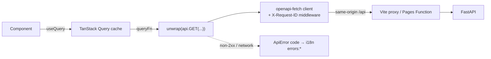

# Frontend architecture

This page summarises how the frontend is built. The cross-repo design is in the backend
repo's [plan.md](https://github.com/poornimapm/tech-toppings-backend-v1/blob/develop/docs/plan.md)
and [ADRs](https://github.com/poornimapm/tech-toppings-backend-v1/tree/develop/docs/adr).

## Layers

| Layer              | Folder              | May import                               |
| ------------------ | ------------------- | ---------------------------------------- |
| Core               | `src/core`          | libraries                                |
| Platform           | `src/platform`      | core, design-system                      |
| Design system      | `src/design-system` | core                                     |
| Modules (Phase 3+) | `src/modules/<key>` | core, design-system, platform public API |

Imports always use the `@/` alias. From Phase 3, ESLint restricted-import rules stop modules
importing each other, and stop them reaching into platform internals.

## Data flow

- **Types.** `src/core/api/schema.d.ts` is generated from the backend's OpenAPI schema
  (`npm run gen:api`). Paths, params and bodies are type-checked against the real API,
  including the error envelope.
- **Errors.**
  - `unwrap()` throws one `ApiError(status, code, message, details, requestId)`.
  - UI code translates by `code` using `errorKey()`, which falls back to `UNKNOWN` for codes
    it doesn't know.
  - `requestId` matches the backend's log lines.
- **Retries.** The default query client retries only transient failures (network, 502, 503,
  504), at most twice. 4xx responses are never retried.

## Server availability (free-tier cold starts)

`useServerStatus()` polls `/healthz`:

| State      | Meaning                                        |
| ---------- | ---------------------------------------------- |
| `checking` | First request is in flight                     |
| `waking`   | Still pending after `VITE_WAKE_THRESHOLD_MS`   |
| `online`   | `/healthz` answered                            |
| `offline`  | Retry budget (`VITE_WAKE_MAX_WAIT_MS`) used up |

- Retries back off at 1 s, 2 s, 4 s, then every 5 s.
- `ServerStatusBanner` explains the waking state and offers _Try again_ when offline. It is
  a polite live region.
- `useReadiness()` (`/readyz`) runs only once the API is online.

## Theming

- `src/core/theme/tokens.css` defines semantic CSS variables for light (`:root`) and dark
  (`[data-theme='dark']`), mapped into Tailwind with `@theme inline`.
- The theme store (Zustand, persisted as `tt-theme`) holds `light`, `dark` or `system`.
  `useApplyTheme()` resolves `system` via `matchMedia` and writes `<html data-theme>`.
- `tokens.test.ts` parses the CSS and asserts WCAG-AA contrast (≥ 4.5:1) for every
  foreground/background pair in both themes.

## Internationalisation

- i18next with namespaces `common` and `errors` (modules add their own lazily from Phase 3).
- Detection order: `localStorage` (`tt-language`), then the browser.
- `<html lang>` follows the active language.
- Keys are typed through `CustomTypeOptions`, so a misspelt key fails `tsc`.
- `i18n.test.ts` fails if Tamil or Hindi miss or add any key compared to English, or lose an
  interpolation placeholder.

## Routing

- React Router 8 data router (`src/platform/shell/routes.tsx`).
- The root route renders `AppLayout` (skip link, header, status banner, `<main>`), with
  `RouteErrorPage` as its error element.
- Pages are lazy (`route.lazy`). Unknown paths render `NotFoundPage`.
- `AppErrorBoundary` catches failures outside the router.

## Testing

| Level            | Tooling                                 | Notes                                                                                                                                          |
| ---------------- | --------------------------------------- | ---------------------------------------------------------------------------------------------------------------------------------------------- |
| Unit / component | Vitest + Testing Library                | jsdom; `src/test/setup.ts` installs MSW (`onUnhandledFrame: 'error'`), a `matchMedia` fake, and resets i18n, theme and storage after each test |
| Accessibility    | vitest-axe                              | Axe's colour-contrast rule can't run in jsdom; `tokens.test.ts` covers contrast instead                                                        |
| Conventions      | `src/test/conventions.test.ts`          | Kebab-case file and folder names                                                                                                               |
| Smoke            | Playwright (Chromium in `node_modules`) | Runs against `vite build` + `vite preview`, with the API stubbed through `page.route`                                                          |
